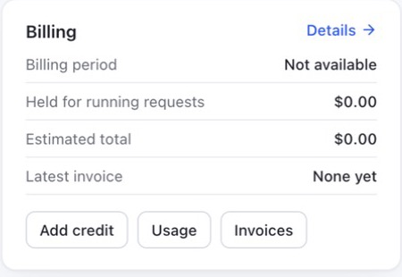
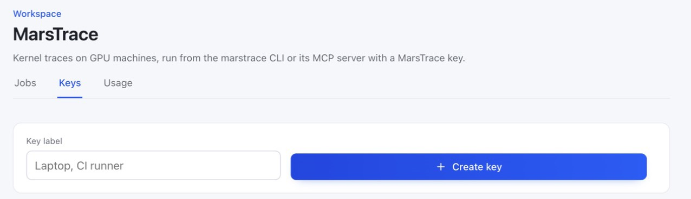

# MarsTrace

Profile and optimize CUDA kernels on cloud GPUs, straight from your coding agent. You don't need a local GPU.

[中文](README.zh.md)

## 1. Get an API key

1. Sign up at [console.marscompute.ai/register](https://console.marscompute.ai/register).

   

2. Add credit on the **Overview** page.

   

3. Open **MarsTrace › Keys** and create a key (`mt_live_...`). It is shown only once.

   

## 2. Connect your agent

```bash
pip install 'git+https://github.com/mars-compute-ai/MarsTrace@v0.3.0'
export MARSTRACE_API_KEY=mt_live_...
```

For Claude Code:

```bash
claude plugin marketplace add mars-compute-ai/MarsTrace
claude plugin install marstrace@marscompute
```

For other agents, add `marstrace mcp` as a stdio MCP server with `MARSTRACE_API_KEY` in its environment (see [.mcp.json](.mcp.json)).

## 3. Ask

Then ask your agent in plain words, for example:

> Trace `square_matrix_mul` in `src/matmul.cu` on an H200 with grid (16,16) and block (16,16), and tell me where the time goes.

The agent prepares the job, shows you its estimated cost, submits it, and reads you the result.

## Modes

| Mode | What you get | Time |
|---|---|---|
| **Profile only** (`fast`) | A timeline inside your kernel (per loop, phase and warp role), with an analysis of where the time goes | minutes |
| **Thinking, light** (`thinking-light`) | The profile, then an agent optimizes your kernel and returns a patch and a report | about 1 hour |
| **Thinking, heavy** (`thinking-heavy`) | The same, with a larger budget for deeper changes | up to 5 hours |

The thinking modes need your source code, plus commands to build, run and check it. The agent keeps a change only if it is measurably faster and still passes your check.

GPUs: H200 and B200, with CUDA 13.0.

## Billing

You pay for the agent's tokens; GPU time is free. Before you submit, `marstrace estimate` shows the typical cost and a hard cap. A job that delivers nothing usable is free.

## More

- [docs/protocol.md](docs/protocol.md): every option, if you'd rather use the `marstrace` CLI directly
- [examples/](examples/): a profiling job and an optimization job you can copy
- Your code runs on a fresh GPU machine with no network, which is deleted afterwards. Uploads are kept for 24 hours and results for 30 days.
- Questions and bugs: [open an issue](https://github.com/mars-compute-ai/MarsTrace/issues)

## License

Source-available under [PolyForm Noncommercial 1.0.0](LICENSE). MarsCompute customers may also use it commercially to access MarsTrace ([details](LICENSE-ADDITIONAL-PERMISSION)).
