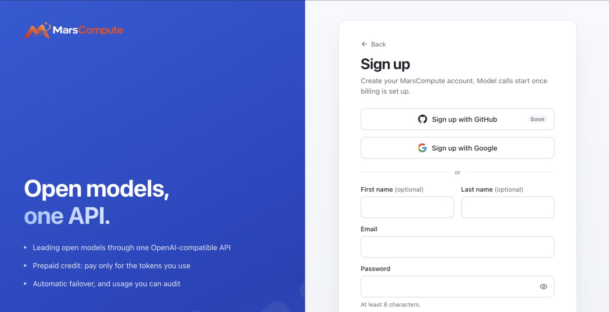
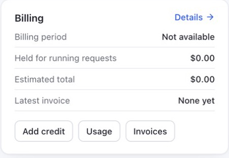
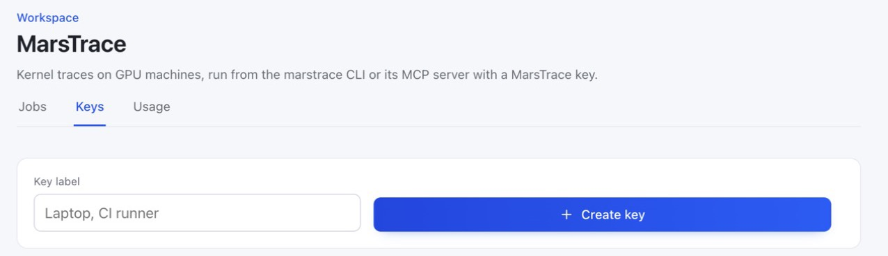

# MarsTrace

在云端 GPU 上分析和优化 CUDA kernel，直接让你的 coding agent 来做，本地不需要 GPU。

[English](README.md)

## 1. 拿到 API key

1. 在 [console.marscompute.ai/register](https://console.marscompute.ai/register) 注册账号。

   

2. 在 **Overview** 页面充值。

   

3. 打开 **MarsTrace › Keys**，创建一个 key（`mt_live_...`）。key 只显示一次，请自己保存好。

   

## 2. 接上你的 agent

```bash
pip install 'git+https://github.com/mars-compute-ai/MarsTrace@v0.3.0'
export MARSTRACE_API_KEY=mt_live_...
```

Claude Code：

```bash
claude plugin marketplace add mars-compute-ai/MarsTrace
claude plugin install marstrace@marscompute
```

其他 agent：把 `marstrace mcp` 配成 stdio MCP 服务，环境变量里带上 `MARSTRACE_API_KEY`（参考 [.mcp.json](.mcp.json)）。

## 3. 直接说

直接用大白话吩咐 agent，比如：

> 在 H200 上 trace `src/matmul.cu` 里的 `square_matrix_mul`，grid (16,16)、block (16,16)，告诉我时间都花在哪。

agent 会准备好 job，先给你看预估费用，再提交，最后把结果读给你听。

## 模式

| 模式 | 得到什么 | 用时 |
|---|---|---|
| **只做 profile**（`fast`） | kernel 内部的时间线（按循环、阶段、warp 角色），加上时间花在哪的分析 | 几分钟 |
| **Thinking 轻度**（`thinking-light`） | 先 profile，再由 agent 优化你的 kernel，交付 patch 和报告 | 约 1 小时 |
| **Thinking 重度**（`thinking-heavy`） | 同上，预算更大，能做更深的改动 | 最长 5 小时 |

Thinking 模式需要你的源码，以及构建、运行、校验正确性的命令。agent 只保留实测更快、而且仍然通过校验的改动。

GPU：H200、B200 和 B300，CUDA 13.0。

## 计费

按 agent 用的 token 收费，GPU 时间不另收。提交前 `marstrace estimate` 会给出常见花费和强制上限。没有交付可用结果的 job 不收费。

## 更多

- [docs/protocol.md](docs/protocol.md)：所有选项，适合想直接用 `marstrace` 命令行的人
- [examples/](examples/)：一个 profile 示例和一个优化示例，可以直接照抄
- 你的代码跑在一台全新、不联网的 GPU 机器上，用完即删。上传的文件保留 24 小时，结果保留 30 天。
- 问题和 bug：[提 issue](https://github.com/mars-compute-ai/MarsTrace/issues)

## 许可证

以 [PolyForm Noncommercial 1.0.0](LICENSE) 公开源码（source-available，不是 OSI 意义上的开源）。MarsCompute 的客户还可以出于商业目的用它访问 MarsTrace（[详情](LICENSE-ADDITIONAL-PERMISSION)）。
